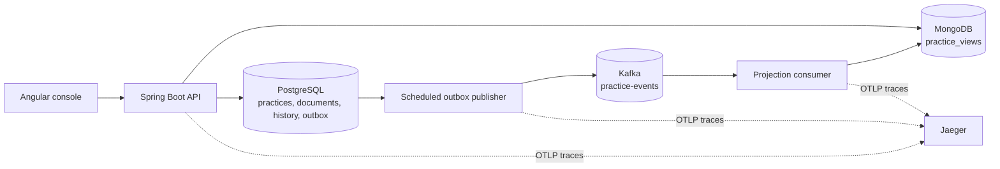

# Reliable Workflow Platform

Threadline coordinates practices, documents, and approvals through an authoritative PostgreSQL write model and a Kafka-fed MongoDB dashboard. The Angular console shows the current PostgreSQL state beside the projected event history, including the gap while the read model catches up. All seed content and branding are fictional.

## Run locally

Requirements: Docker Compose, 4 GB of available Docker memory, and ports `4200`, `8092`, `5435`, `9094`, `27018`, and `16687` available.

```bash
cp .env.example .env
docker compose up -d --build
```

Open the [operations console](http://localhost:4200), [API health](http://localhost:8092/actuator/health), or [Jaeger traces](http://localhost:16687). The first start seeds one approved practice with a synthetic text document. Wait for the dashboard to show version 3; the seed follows the same command and outbox path as user actions.

```bash
cd backend && mvn test
cd ../console && npm ci && npm run build
cd .. && python3 scripts/verify-recovery.py
```

The recovery script requires the Compose stack. It pauses the consumer, creates a practice, checks that PostgreSQL remains available while MongoDB lags, resumes delivery, injects one consumer failure, completes approval, and rebuilds MongoDB by replaying Kafka. To stop services without deleting volumes, run `docker compose down`. `docker compose down -v` deletes all local data.

## One workflow, two models



PostgreSQL owns the practice status, document bytes and SHA-256 checksum, ordered event history, and outbox. Each command writes its state change, history event, and outbox row in one database transaction. Kafka carries `PracticeCreated`, `DocumentUploaded`, and `PracticeApproved`; it does not own the current status. MongoDB stores only a derived dashboard view. The console requests both models and displays `PostgreSQL version − MongoDB sequence` as projection lag. [The event sequence diagram](docs/events.md) shows the complete path.

| Command | Required state | New state | Event |
| --- | --- | --- | --- |
| Create practice | none | `CREATED` | `PracticeCreated` |
| Upload one document | `CREATED` | `DOCUMENTED` | `DocumentUploaded` |
| Approve practice | `DOCUMENTED` | `APPROVED` | `PracticeApproved` |

An invalid transition returns HTTP 409. A missing practice or invalid input returns HTTP 400. The single-document step keeps this workflow narrow: adding more documents or rejection states would require explicit transitions and event schema changes.

## API

| Method and path | Purpose |
| --- | --- |
| `POST /api/practices` | Create with JSON `{ "title": "..." }` |
| `GET /api/practices` | List authoritative practice status and version |
| `GET /api/practices/{id}` | Read authoritative status, document metadata, and event history |
| `POST /api/practices/{id}/documents` | Upload multipart field `file`, up to 1 MB |
| `POST /api/practices/{id}/approve` | Approve a documented practice |
| `GET /api/dashboard` | Read the MongoDB projection |
| `GET /api/dashboard/health` | Consumer pause state, outbox backlog, injected failure and duplicate counts |
| `POST /api/dashboard/pause` | Pause Kafka consumption |
| `POST /api/dashboard/resume` | Resume Kafka consumption |
| `POST /api/dashboard/fail-next` | Fail one delivery so the listener retries it |
| `POST /api/dashboard/duplicate-last/{id}` | Re-send the last event for a practice to verify idempotency |
| `POST /api/dashboard/rebuild` | Clear MongoDB view and replay retained Kafka events |

Example requests:

```bash
PRACTICE_ID=$(curl -s -X POST http://localhost:8092/api/practices \
  -H 'Content-Type: application/json' -d '{"title":"Test workspace access"}' | python3 -c 'import json,sys; print(json.load(sys.stdin)["id"])')
printf 'Synthetic approval evidence\n' > /tmp/threadline-evidence.txt
curl -s -F "file=@/tmp/threadline-evidence.txt" "http://localhost:8092/api/practices/$PRACTICE_ID/documents"
curl -s -X POST "http://localhost:8092/api/practices/$PRACTICE_ID/approve"
curl -s "http://localhost:8092/api/practices/$PRACTICE_ID"
```

## Failure and recovery

**Kafka is unavailable.** The database transaction still commits. The publisher keeps the event in `outbox` and retries on its next scheduled run. The dashboard remains behind until publication and consumption succeed. The outbox row is marked published only after Kafka acknowledges it. A crash between acknowledgement and the PostgreSQL update can resend the event, so delivery is at least once.

**The consumer stops.** In the console, click **Pause consumer**, create a practice, and compare its PostgreSQL version with the empty or older MongoDB projection. Click **Resume**; the consumer reads the retained events and catches up. The API keeps serving authoritative state during the pause.

**A consumer attempt fails.** Click **Fail next event** before uploading a document or approving. The listener raises once, then Spring Kafka retries the same record after 800 ms. Persistent failures keep the partition retrying rather than committing the offset and losing the event.

**Kafka delivers a duplicate.** Click **Resend last event**. The API publishes the last stored event a second time solely for this fault check. The `duplicateDeliveries` counter increases, while the MongoDB event history and document list remain unchanged.

**MongoDB is lost or incorrect.** Click **Rebuild view** or call `POST /api/dashboard/rebuild`. The API stops the normal listener, drops the projection collection, reads `practice-events` from the beginning with a temporary Kafka consumer group, applies each event, then restarts the listener. Replaying a retained event is safe because the reducer ignores sequences already applied. The API remains the source for current status while replay runs. The rebuild is synchronous and can briefly block dashboard calls.

**Events arrive out of order.** Each event has a monotonic sequence per practice. The MongoDB document stores future events in `pending` and applies them only when the missing sequence arrives. An event at or below the applied sequence is ignored. A conflicting event ID at the same pending sequence raises an error for investigation. The outbox selects the earliest unpublished event per practice, and the single-partition topic preserves publish order for normal traffic.

Run all recovery checks with `python3 scripts/verify-recovery.py`; the JUnit reducer tests also cover duplicate delivery, out-of-order arrival, and conflicting events. To inspect an individual practice trace, create a new practice and search for service `reliable-workflow-api` in Jaeger. The API request carries a `practice.id` span attribute; the outbox stores W3C trace context and uses it as the parent of the publish span. The Java agent instruments JDBC, Kafka producer/consumer, and MongoDB calls. Logs contain IDs and error types, not document contents.

## Design limits

- This is one Spring Boot process: API, publisher, and consumer share a deployment. It avoids a second service with no distinct responsibility, while keeping their classes separate.
- The dashboard controls and write API have no authentication and must be kept on a trusted local network. Add role-based access, TLS, and audit records before exposing them beyond local development.
- Kafka retains events for seven days in Compose. Rebuild succeeds only while the full history is retained. Durable long-term replay requires a longer retention policy or an archival event log.
- One topic partition favors observable ordering over throughput. Production scaling would require partition planning, per-practice publisher ordering, and load tests.
- MongoDB uses optimistic version checks on each view document. It is a projection, so deleting it does not change PostgreSQL state.
- Documents are capped at 1 MB and stored directly in PostgreSQL for atomicity. Large files would need object storage with a staged upload and reconciliation protocol.
- The API returns HTTP 400 for an unknown ID, keeping the code small; a full API would use typed errors and HTTP 404.
- OpenTelemetry spans use a local Jaeger collector. The stored trace context is not business data and expires with the outbox row only when the database is reset.

## Repository layout

`backend/` contains the Spring Boot API, migration, outbox, consumer, and tests. `console/` contains the single-page Angular UI. `scripts/verify-recovery.py` is the executable integration check. `.github/workflows/ci.yml` builds both applications and exercises the running Compose stack on each push and pull request.
